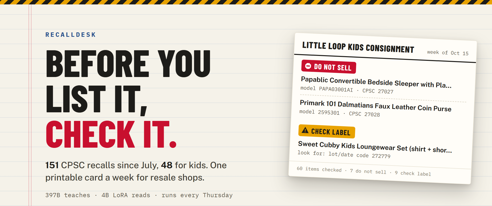
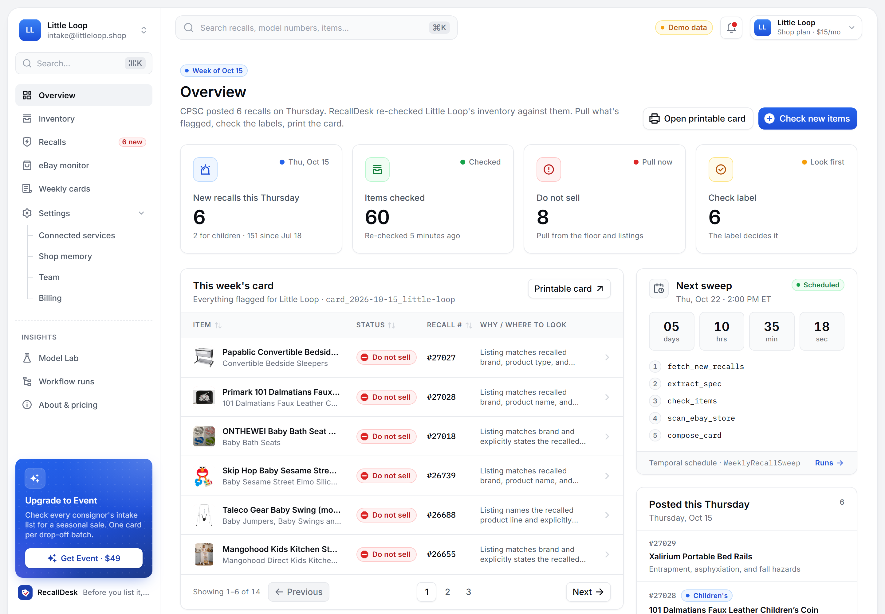
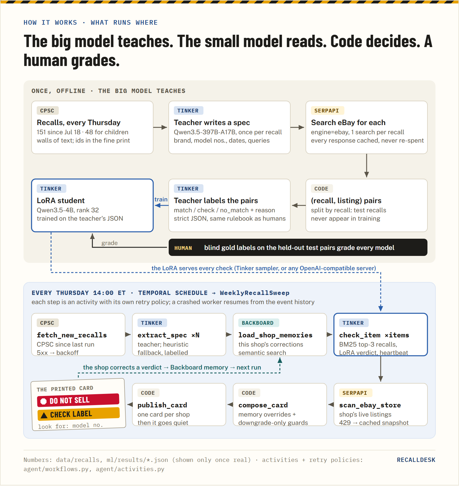

# RecallDesk

> **Before you list it, check it.** A weekly CPSC recall check for kids' consignment shops and eBay resellers.



Reselling a recalled children's product is a federal violation in the US, and recalled baby gear keeps turning up on
resale sites. CPSC posts about a dozen recalls every Thursday, and in **73 of the 151 recalls since 2026-07-18 the model
number that decides it is only in the description's fine print**. eBay sellers almost never type it into a title.

RecallDesk reads every recall, checks a shop's inventory and eBay listings against it, and prints **one card a week**:
**DO NOT SELL** for items that are the recalled product, **CHECK LABEL** (with exactly where the label is) for items
only a person holding it can decide. Then it goes quiet until next Thursday.

**The rule of the build: the big model teaches, the small model reads, code decides.**

[](https://render.com/deploy?repo=https://github.com/SoumyaEXE/recalldesk)



## How it works



| Piece | What it does |
| --- | --- |
| **CPSC Recalls API** | 591 recalls: every recall since 2026-07-18 (151) plus children's-product recalls since 2023 |
| **Teacher** — `Qwen/Qwen3.5-397B-A17B` on [Tinker](https://thinkingmachines.ai/tinker/) | Turns each recall into an identification spec (model numbers, date codes, sold window, where the label is) and labels 3,300 (recall, listing) pairs with one rulebook ([`ml/LABELING.md`](ml/LABELING.md)) |
| **Student** — `Qwen/Qwen3.5-4B` + LoRA (rank 32) on Tinker | The model that actually runs every week: `match` / `check` / `no_match` per item, strict JSON |
| **SerpApi eBay engine** | 237 searches → 12,562 unique live eBay listings for recalled products (cached; seller names hashed) |
| **Temporal** | `WeeklyRecallSweep` schedule, Thursdays 2:00 PM ET: fetch recalls → specs → per-shop check → eBay store scan → card. Per-activity retries, heartbeats, crash-safe |
| **Backboard** | One memory store per shop: corrections ("ours is the 2022 model") are saved as memories, retrieved semantically next run, and applied by code |
| **Dashboard** | Next.js + [BoardUI](https://boardui.com): overview, inventory, recalls, eBay monitor, weekly cards, shop memory, workflow runs, Model Lab |

## Results (held-out recalls, 293 pairs)

| Model | Accuracy | False alarms | $ / 1k checks |
| --- | --- | --- | --- |
| Qwen3.5-4B base | 0.512 | 120 / 255 | $0.22 |
| Qwen3.5-4B base + teacher's long prompt | 0.625 | 106 / 255 | $0.37 |
| Keyword / identifier heuristic | 0.864 | 22 / 255 | $0 |
| **Qwen3.5-4B + RecallDesk LoRA** | **0.918** | **12 / 255** | **$0.19** |
| Qwen3.5-397B teacher | 0.884 | 34 / 255 | $2.20 |

Graded against the teacher's labels with rule 7 enforced by code — **not human labels**. It measures how faithfully the
4B learned the rulebook on recalls it never saw. Split by recall, no recall or listing overlap. Full protocol, paired
McNemar tests and caveats in [`ml/README.md`](ml/README.md) and [`ml/results/eval.json`](ml/results/eval.json).

## Run it

```bash
git clone https://github.com/SoumyaEXE/recalldesk && cd recalldesk
cp .env.example .env     # every key is optional: with none, it runs the labelled heuristic + committed data

python -m uv venv --python 3.12 agent/.venv
python -m uv pip install --python agent/.venv/Scripts/python.exe -r agent/requirements-tinker.txt
agent/.venv/Scripts/python -m agent.dev --schedule    # Temporal dev server (:7233, UI :8233) + worker + API (:8000)
agent/.venv/Scripts/python -m agent.demo_crash        # hard-kills the worker mid-run and shows it resume

cd web && npm install && npm run dev                  # dashboard on :3000 (falls back to real-data fixtures)
```

On Linux/macOS use `agent/.venv/bin/python`. The ML pipeline (fetch → specs → eBay scan → pairs → teacher → train → eval)
is step by step in [`ml/README.md`](ml/README.md); the backend in [`agent/README.md`](agent/README.md); the UI in
[`web/README.md`](web/README.md). Everything shares one contract: [`CONTRACT.md`](CONTRACT.md).

**Deploy:** the Render Blueprint ([`render.yaml`](render.yaml)) creates the agent runtime (Temporal dev server + worker
+ API) and the static dashboard wired to it. Render asks for the keys on first deploy.

## What this is not

- Not legal advice, and not a replacement for [cpsc.gov/Recalls](https://www.cpsc.gov/Recalls).
- Text only: it reads titles and specs, it can't see the label in a photo. That's why **CHECK LABEL** exists.
- US CPSC recalls only.

Built for the [DEV Hacktoberfest Open-Source AI Challenge, Week 2: Side Hustle](https://dev.to/challenges/hacktoberfest-week2-2026-10-12)
by [@soumyadeepdey](https://dev.to/soumyadeepdey). Builds on patterns from the author's earlier
[TrailTruth](https://github.com/SoumyaEXE/trailtruth). MIT licensed.
